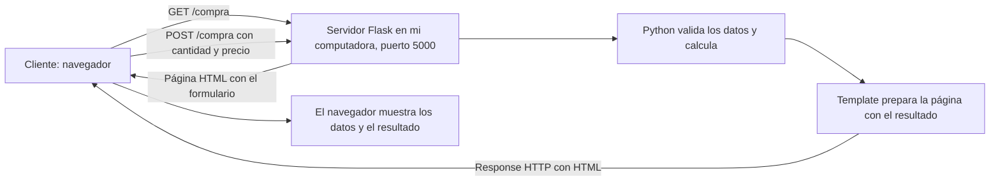

# Explicación técnica

# ¿como debo abrir mi app o que pasa si lo que me da es una ip?

Cuando escribo `http://127.0.0.1:5000` en el navegador, el **cliente** solicita el portal que se está ejecutando en mi computadora. La **dirección IP** `127.0.0.1` señala esta computadora y el **puerto** `5000` identifica el punto por el que la aplicación recibe solicitudes.

El navegador es el **cliente**: solicita las páginas y muestra el resultado. La computadora que está ejecutando el portal es el **servidor**. Se comunican por medio de **HTTP**. Por ejemplo, cuando selecciono «Compra», el cliente envía una **request** con la **ruta** `/compra`. **Flask**, que está escrito en **Python**, busca qué debe hacer para esa ruta y responde con la página solicitada.

Lo que veo en el navegador es el **frontend** de la aplicación. Está formado por **HTML**, que organiza el contenido, y **CSS**, que define su apariencia. También utilizo **Bootstrap** para que las páginas, los botones, el menú y las tarjetas se adapten a distintos tamaños de pantalla. El carrusel de Inicio y el menú desplegable en pantallas pequeñas usan **JavaScript** de Bootstrap para sus controles. JavaScript no hace los cálculos de las calculadoras.

Por ejemplo, en Compra escribo la cantidad de artículos y su precio. Al enviar el formulario, el navegador manda los datos usando **POST** a la ruta `/compra`; los valores viajan en la solicitud al servidor. En el **backend**, Flask recibe la información y Python comprueba los datos y calcula el subtotal, el descuento —si corresponde— y el total.

Flask entrega los datos y el resultado a un **template**. El template prepara una página HTML que incluye lo que escribí y las cifras calculadas. El servidor envía esta página al navegador mediante una **response** HTTP, y el navegador la presenta. Así puedo ver el resultado en la misma página, en lugar de buscarlo en la consola.

## Diagrama de comunicación

En el diagrama, el **cliente** se comunica con el **servidor** local mediante `127.0.0.1:5000`: primero solicita la **ruta** `/compra`, después envía los campos con **POST** y recibe una **response** HTTP con el **HTML** preparado por Flask.

